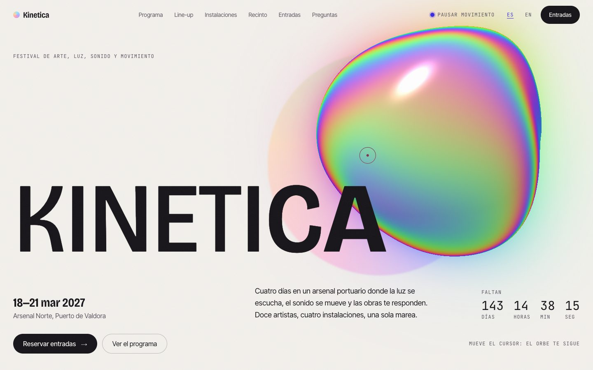
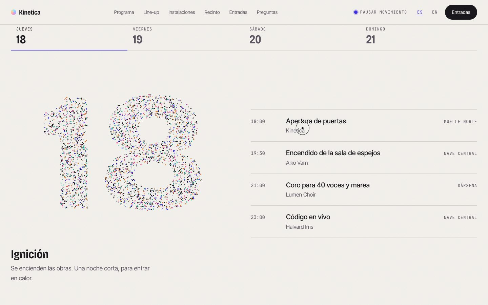
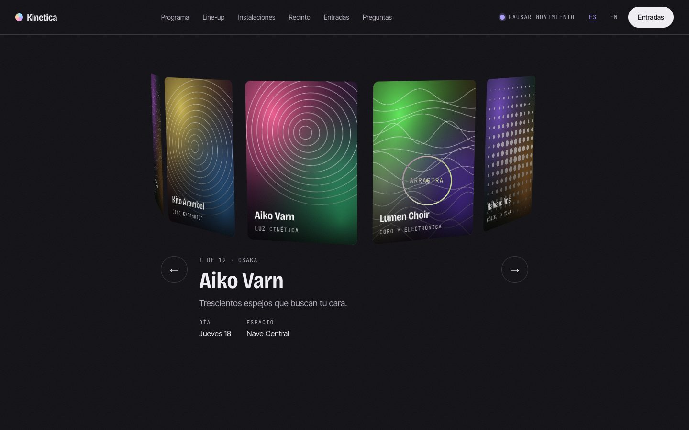
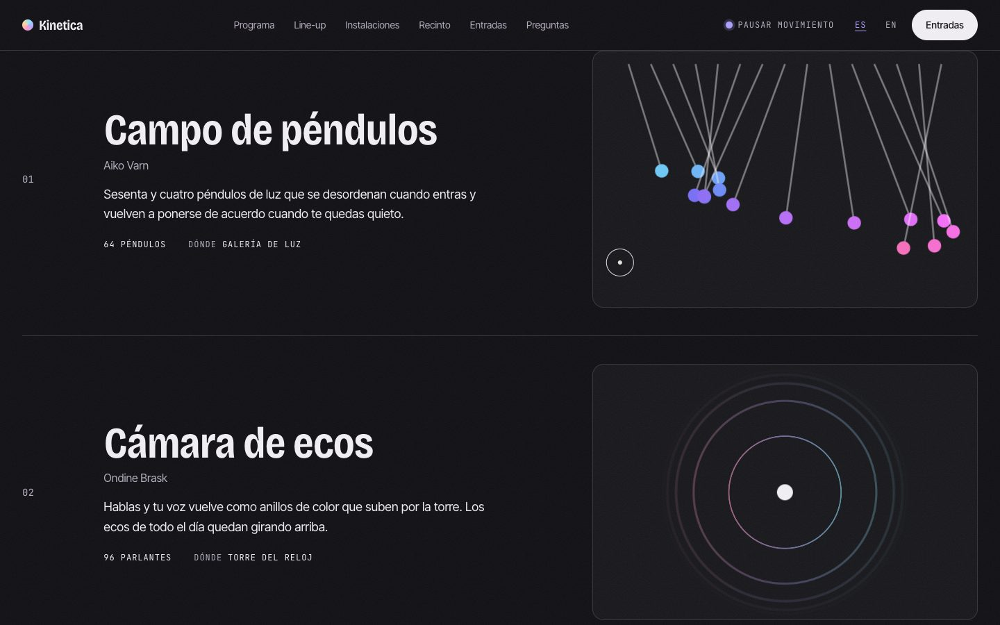
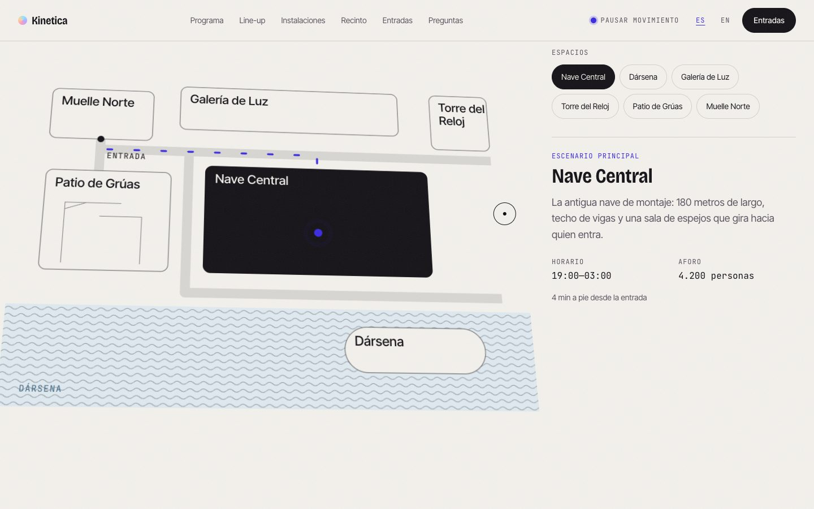
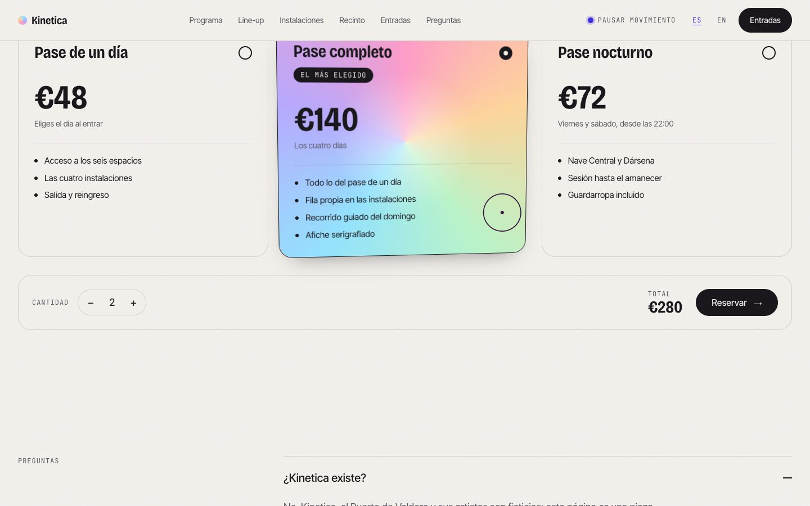
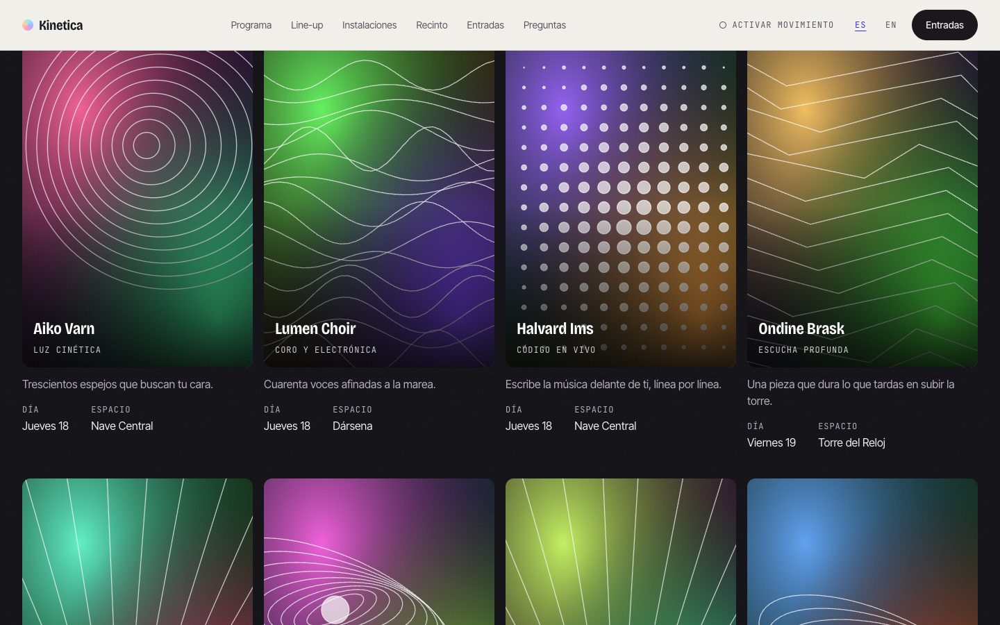
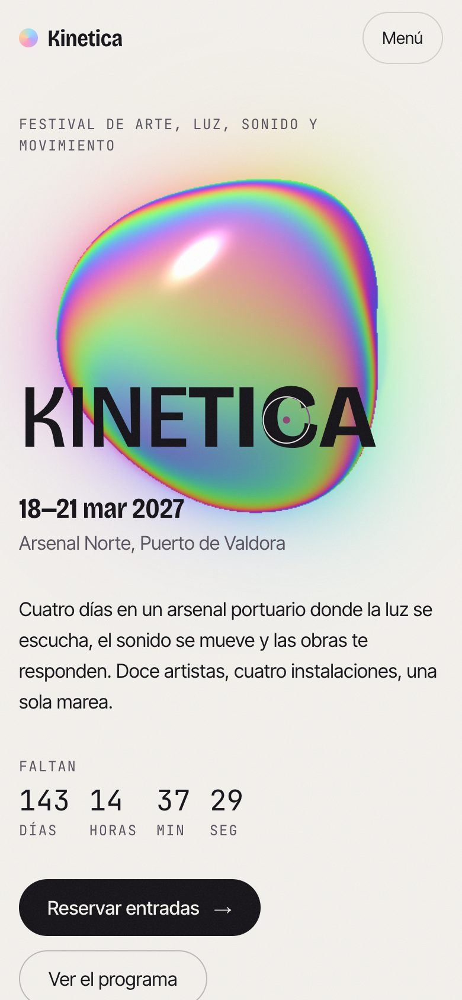
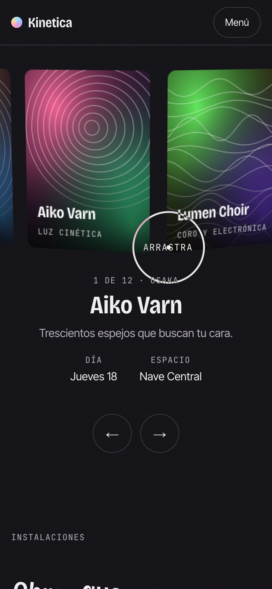
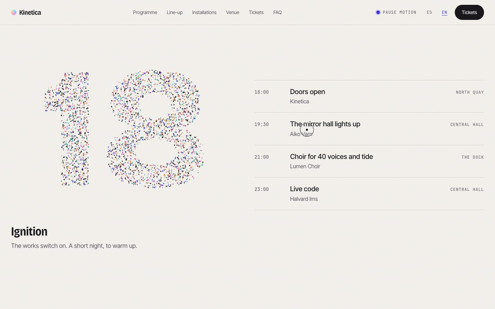

# Kinetica

The landing page of a fictional festival of art, light, sound and motion:
four days in a harbour arsenal, twelve artists, four installations. The brief
was a page that feels **alive**: an iridescent orb that follows you, particles
that assemble the dates, type that swells under the cursor, a line-up you can
spin, a map that walks you to each stage. Bilingual (ES/EN), no backend.

Kinetica, the Port of Valdora and every artist on the page are invented, and
the page says so (in the FAQ, the ticket dialog and the footer).



---

## Contents

- [The page](#the-page)
- [Stack](#stack)
- [Design direction](#design-direction)
- [Technical decisions](#technical-decisions)
- [Nothing gets cut off](#nothing-gets-cut-off)
- [Accessibility](#accessibility)
- [Performance](#performance)
- [Running it](#running-it)

---

## The page

| Section | What moves |
|---|---|
| Opening | A raymarched iridescent orb (WebGL2) that leans towards the pointer, bulges where it is, gets restless as you scroll and ripples when you click. The wordmark's letters swell in weight and width near the cursor. A live countdown. |
| Manifesto | Two bands of words that drift, speed up and lean with your scroll. The manifesto lights up word by word as you read it; the figures count up. |
| Programme | Four days as tabs. Picking one bursts a cloud of 3,200 particles and reassembles it into that date; the pointer scatters them. |
| Line-up | Twelve cards on a 3D ring: drag it (with inertia and snap), use the arrows or the keys, or press a card. Each card's art is generated from the artist. |
| Installations | Four live pieces: a pendulum wave, an echo chamber, a chromatic tide and a wall of mirrors that turn towards the pointer. |
| Venue | An SVG map of the arsenal, tilted in 3D. Choose a space and a walking route draws itself from the entrance. |
| Tickets | Three passes as holographic foil cards that tilt and catch the light. Quantity, total, and a dialog that says plainly it is all fictional. |
| FAQ | Native `<details>`, with the height animating where the browser can. |

Between them, the **lights go down**: while the line-up and the
installations hold the middle of the screen the whole page turns to night,
and back to paper after.







---

## Stack

| Purpose | Choice |
|---|---|
| Build | Vite 8 (Rolldown), static prerender of the HTML |
| UI | React 19, TypeScript 6 in strict mode |
| Styling | Tailwind CSS v4, tokens in `src/index.css` |
| Orb | Raw WebGL2, one fragment shader, lazy-loaded (6 KB) |
| Particles | Canvas 2D, lazy-loaded (3 KB) |
| Scroll and motion | GSAP 3 + ScrollTrigger, Lenis, one shared `requestAnimationFrame` |
| Checks | `@axe-core/playwright`, Lighthouse, a clipping check, oxlint, Prettier |

Strictness is `strict` plus `noUncheckedIndexedAccess`,
`exactOptionalPropertyTypes`, `noImplicitOverride` and `noImplicitReturns`.

---

## Design direction

**«Espectro»: a light ground where every colour comes from light itself.**
The reference was the cinematic-site genre (GetLayers and the like: a 3D
object as protagonist, iridescence, kinetic type, depth carousels), built
here from scratch and turned around: instead of a black page with neon, ink
on warm paper, and the colour arrives only through the orb, the foil, the
card art and the installations. The interface itself stays monochrome, with
one accent kept for what you can touch.

- **Type:** Bricolage Grotesque on its variable `wght` and `wdth` axes for
  display (the axes are what the kinetic type animates, so glyphs stay crisp
  instead of being scaled), Inter Tight for text, JetBrains Mono for labels
  and figures (tabular numerals).
- **One easing** for the whole page, `cubic-bezier(0.22, 1, 0.36, 1)`.
- **Grain:** a static SVG `feTurbulence` at 7 % over everything.
- **Night scene:** the same roles (`fondo`, `tinta`, `tenue`, `linea`,
  `acento`) redefined, so every component works in both without knowing.

| Token | Hex | Role | Contrast |
|---|---|---|---|
| `--color-papel` | `#f3f1ec` | day ground | — |
| `--color-tinta-papel` | `#141217` | day text | 16.5:1 on papel |
| `--color-grafito` | `#57525e` | day secondary text | 6.7:1 on papel |
| `--color-voltaje` | `#3a2ae0` | **interactive only** (day) | 7.2:1 on papel |
| `--color-noche` | `#100f14` | night ground | — |
| `--color-nieve` | `#f1eff4` | night text | 16.7:1 on noche |
| `--color-humo` | `#b3aebd` | night secondary text | 8.8:1 on noche |
| `--color-lila` | `#ab9fff` | **interactive only** (night) | 8.3:1 on noche |

---

## Technical decisions

**No three.js.** The orb is a single raymarched signed-distance field: a
sphere displaced by a few sines, coloured with a thin-film palette (a
phase-shifted cosine on the Fresnel term). That is one shader on one
triangle; three.js would be 150 KB to draw a quad. Rays that miss a bounding
sphere return at once, so most of the canvas never marches.

**The orb adapts and sleeps.** Phones get fewer march steps and a lower render
scale; anywhere, if frames run long for half a second the render scale steps
down (never below half). The loop stops when the hero is off screen or the tab
is hidden, and the module only loads after `load`, when the browser is idle.

**Particles on a 2D canvas.** The date is drawn into an offscreen canvas,
sampled into target points, and 3,200 points (1,400 on phones) spring towards
them. When the date changes they get an outward kick first, so the change
reads as a reassembly. The loop stops itself once the cloud settles.

**The ring is CSS 3D.** Twelve buttons on a cylinder (`rotateY` +
`translateZ`, radius from the card width), the angle driven by pointer drag,
inertia and GSAP tweens. The cards are real buttons, so focus, keyboard and
screen readers come for free; focusing a card brings it to the front.

**Card art is generated.** Each artist gets an SVG: a gradient field and one
of six line drawings, varied by a seeded PRNG of the name. The base hue steps
by the golden angle around the ring, so neighbours never share a colour. No
photos, nothing to download, nothing that looks like stock.

**Prerendered HTML.** The page is rendered once at build time and hydrated,
so the hero paints with the CSS. The countdown renders empty on the server
(any number would be stale) and fills on mount.

**Metric-matched fallbacks.** Before the web fonts arrive, text is set in
Arial scaled to each font's average advance (`size-adjust` 95.1 % for Inter
Tight, 90.6 % for Bricolage, measured on the hero copy). Without it the hero
paragraph wrapped to four lines, then three, and the whole hero jumped: a
0.2 CLS on phones, now 0.01.

---

## Nothing gets cut off

The previous page (Cordillera) had headlines and animations that clipped on
some screens. This one has a check for it, `scripts/clip-check.mjs`, run at
six sizes (1440×900, 1280×720, 1024×768, 768×1024, 390×844, 360×640) in both
the motion and the reduced build. It screenshots every section and measures
every visible text node's glyph box against every ancestor that clips; it
fails on horizontal page scroll, clipped text, `clip-path` over text and text
past the viewport edge. Both builds pass at every size.

What makes that hold:

- Display type keeps a line-height of 0.95 or more and a little padding, so
  accents (Á, É) and descenders never touch an edge.
- Nothing animates with a mask or `clip-path`. Headings rise and turn into
  place with transforms only, and are never transparent.
- The kinetic wordmark is sized for its widest state (every letter at
  `wdth 100`, `wght 800`, measured at 4.54 em), not its resting one.
- Sections clip only horizontally (`overflow-x: clip`), and only where
  something is meant to leave the screen: the marquee and the ring's side
  cards. The front card is checked like any other text.
- The hero uses `svh`, not `vh`, so the phone URL bar cannot push it.

---

## Accessibility

- **axe-core: 0 violations** in seven runs: desktop and phone, Spanish and
  English, the night scene, the ticket section on a phone, and the reduced
  build on both.
- **Reduced motion is a real version.** With `prefers-reduced-motion`, or
  `?reduced=1`, there is no smooth scroll, no cursor, no idle motion: the orb
  renders one still frame, the date is drawn once, the line-up is a grid, the
  installations hold still, and the night sections paint themselves instead
  of flipping the page.

  

- **A pause switch** in the header (and the phone menu) reloads into that
  version, because several things move on their own for more than five
  seconds (WCAG 2.2.2).
- The programme is a real tab list (arrow keys, Home, End), the passes a real
  radio group, the ticket notice a native `<dialog>`, the FAQ native
  `<details>`.
- The ring announces the front card in a polite live region, but only after
  the visitor moves it, not on every step of the idle drift.
- The orb, the particles, the marquee and the installation pieces are
  decorative and `aria-hidden`; split and kinetic words are read whole.
- `lang` follows the language switch. Skip link, 2 px focus ring in the
  accent, 44 px touch targets.

---

## Performance

Lighthouse 12 against `vite preview` (no compression; Vercel adds it):

| Run | Performance | Accessibility | Best practices | SEO |
|---|---|---|---|---|
| Desktop | 100 | 100 | 100 | 100 |
| Mobile (simulated 4× CPU, slow 4G) | 92 | 100 | 100 | 100 |

Mobile: LCP 2.7 s, TBT 0 ms, CLS 0.01.




---

## Running it

```bash
npm install
npm run dev
```

| Script | What it does |
|---|---|
| `npm run dev` | dev server on `:5173` |
| `npm run build` | typecheck, client build, SSR build, prerender |
| `npm run preview` | serve the production build |
| `npm run lint` | oxlint |
| `npm run format` | Prettier |
| `npm run capture` | regenerate `docs/` and `public/og.jpg` (needs `npm run dev`) |
| `npm run clip` | the clipping check at six sizes (needs `npm run dev`) |
| `npm run a11y` | axe over seven builds (needs `npm run preview -- --port 4173`) |

The three checks take the URL as their first argument, and `clip` takes an
output folder and a query second and third, e.g.
`node scripts/clip-check.mjs http://localhost:4173 /tmp/clip '?reduced=1'`.

`?reduced=1` forces the reduced-motion build; `?reduced=0` forces motion.

### Deploying

Live at **https://kinetica-fest.vercel.app** (`kinetica.vercel.app` was
already taken by another account). The Vercel project `kinetica` is connected
to this repository, so every push to `main` deploys to production. `vercel.json` sets the Vite preset,
`dist` and a year of cache for hashed assets. No environment variables, no
runtime.



---

## License

[MIT](LICENSE). Fonts are under the SIL Open Font License (Bricolage
Grotesque, Inter Tight, JetBrains Mono).
